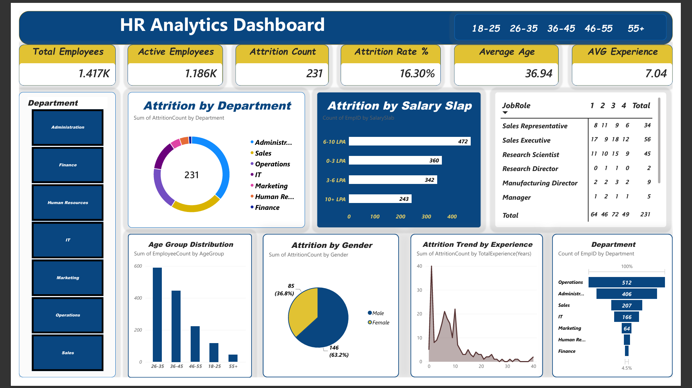

# HR Analytics Dashboard | Power BI

Dashboard to analyze employee attrition and understand why employees leave.

## 📊 KPIs
- **Total Employees:** 1,470
- **Attrition Count:** 237
- **Attrition Rate:** 16.12%
- **Retention Rate:** 83.88%
- **Avg Salary:** 6,502
- **Avg Age:** 37
- **Avg Years at Company:** 7

## 📈 Dashboard Pages

### 1. Overview
- Attrition by Department
- Attrition by Job Role
- Attrition by Salary Slab
- Attrition Trend by Experience

### 2. Why People Leave
- Attrition by OverTime
- Attrition by Marital Status
- Attrition by Distance From Home
- Attrition by Job Role and Experience

## 🔑 Key Insights
- **Sales** has the highest attrition, 36% of total leavers.
- Employees with **0-2 years experience** leave the most.
- Employees who work **OverTime** leave more than others.
- **Single** employees have higher attrition than Married.

## 🛠️ Tools Used
- Power BI
- Excel - Data Cleaning
- DAX Measures

## 📁 Files
- `HR_Analytics_Dashboard.pbix` - Power BI file
- `HR_Employee_Attrition.xlsx` - Cleaned Dataset

## 👤 Author
Ahmed Abdelrehman
